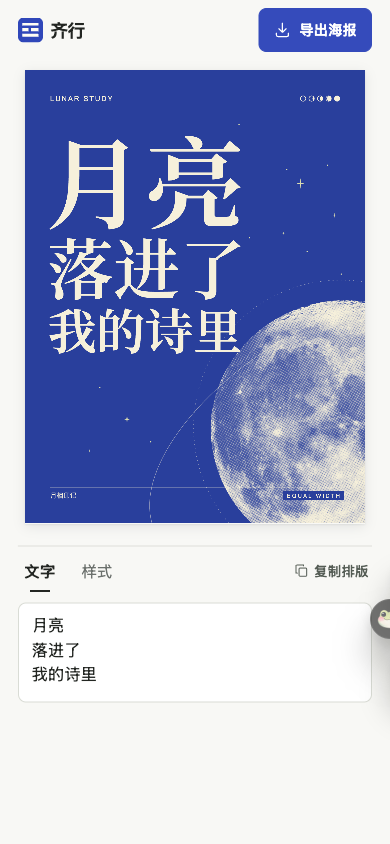
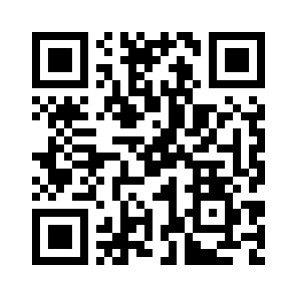

<a href="./README.md">简体中文</a>

# Typepress · Equal-width poster studio

[Try it live](https://equal-width.xiaosang.cc/) · [GitHub](https://github.com/holynova/equal_width)

Each line gets its own type size so its visible edges align with the others. Edit on a phone, copy the typeset lines into a rich text editor, or export the composition as a PNG.

Type or paste one line per row. Choose from three compositions, four typefaces, five palettes, and three aspect ratios. The browser remembers the current draft. Copy writes both HTML and plain text. Pasting into a plain text field preserves line breaks. Rich text appearance depends on the receiving editor and available fonts.

Export produces the same pixels as the canvas preview. The PNG is 1440 pixels wide, with a height of 1920, 1440, or 2560 pixels. Save the file, long-press the image on mobile, or copy the image in browsers that support it.

## Run locally

Run `npm start` with Python 3 installed and open `http://127.0.0.1:8000`. Any static HTTP server can also serve `docs/`. Run `npm run build` with Node.js to copy the app to `dist/`. No frontend dependencies are required.

The renderer measures visible glyph bounds in Canvas. Fonts and the lunar print are hosted locally. The artwork and font credits are listed in [CREDITS.txt](./docs/assets/CREDITS.txt).

Cloudflare Pages builds the `master` branch with `npm run build` after `git push origin master`.

