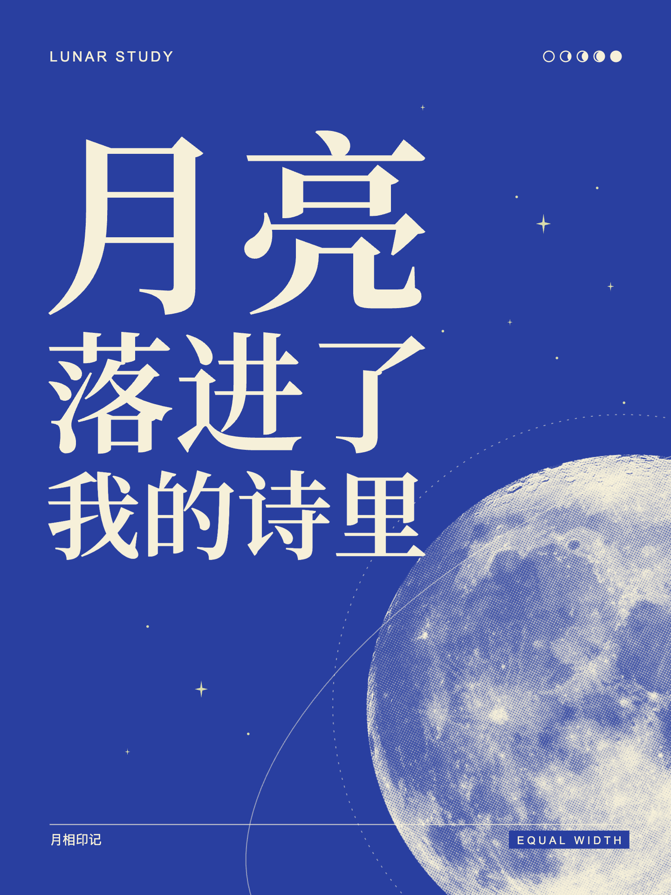
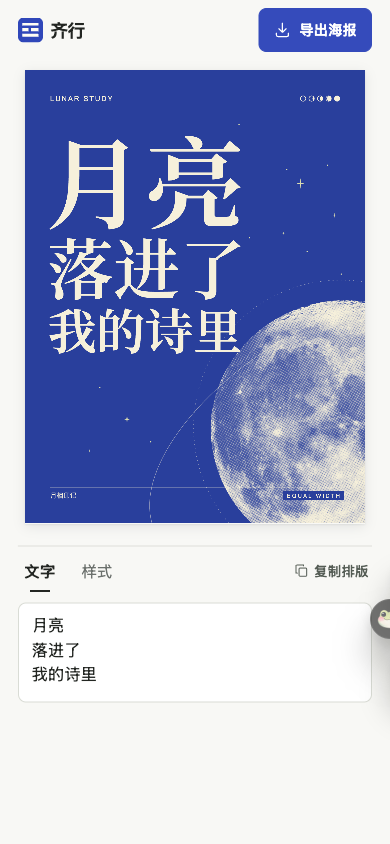

<a href="./README.en.md">English</a>

# 齐行 Typepress · 等宽海报工坊

[在线体验](https://equal-width.xiaosang.cc/) · [GitHub](https://github.com/holynova/equal_width)

长句用小字，短句用大字。齐行逐行测量字形，让每行文字的左右边缘对齐。手机上可以边写边排，把文字粘贴到笔记，或保存成一张海报。

## 从文字到海报

1. 输入多行文字，或用「换个示例」试排。空行和行首、行尾的空白会自动略去。
2. 选择月相印记、几何构成或留白书页。可切换四种字体、五种配色和三种画幅。当前草稿会保存在此浏览器。
3. 「复制排版」同时写入富文本和纯文本。支持 HTML 的编辑器可以保留逐行字号，最终字形取决于目标应用的字体。普通聊天输入框可保留分行。
4. 「导出海报」生成与画布一致的 PNG。可以下载、在手机上长按保存，或在支持图片剪贴板的浏览器里复制图片。

| 画幅 | 导出尺寸 |
| --- | --- |
| 3:4 | 1440 × 1920 px |
| 1:1 | 1440 × 1440 px |
| 9:16 | 1440 × 2560 px |

## 本地运行

需要 Python 3。运行 `npm start` 后，在浏览器打开 `http://127.0.0.1:8000`。也可以用任意静态服务器提供 `docs/`。

`npm run build` 使用 Node.js 的内置文件 API 将源文件复制到 `dist/`。项目无需安装前端依赖，可以部署在网站根目录或子路径下。

## 实现与素材

`docs/poster.js` 通过 Canvas 的字形边界计算每行缩放比例，并根据可用高度对整个字块等比缩小。编辑预览和导出共用同一画布。用户的文字仅在设备上处理。

随站提供思源宋体、霞鹜文楷与站酷庆科黄油体的中文字体子集。月面插图来自 Galileo 探测器拍摄的月球照片，经过单色网点处理。详见[素材来源和字体许可](./docs/assets/CREDITS.txt)。

推送主分支（`git push origin master`）后，Cloudflare Pages 运行 `npm run build`，发布 `dist/`。

